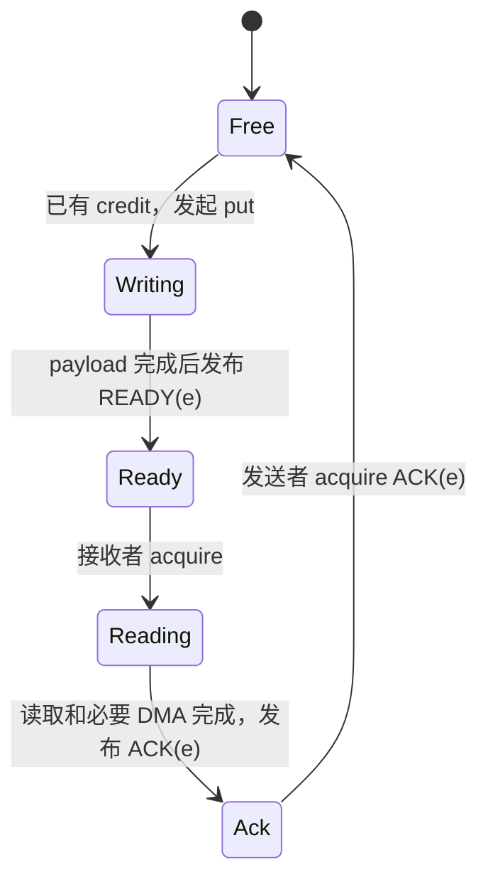

# TileLang Ascend 950 单机多卡 P0 DSL 设计

设计日期：2026 年 10 月 23 日

从新克隆部署和测试见[分布式 P0 测试指南](../testing/distributed_p0.md)。文中的本地产物路径仅标识历史验收记录，日志、输入和流水不随 Git 分发。

状态：已实现并验证 **P0 DSL 的本机功能路径**；原生双卡 transport、P0-A 设备通信合法化及 P0-B 调度仍是设计目标。当前可执行 profile 为 `ascend950_cannsim_v1`，详见第 14 节及[实现与验证记录](distributed_p0_implementation_validation.md)。

原生执行设计目标：当前仓库的 Ascend 950 / AscendC 后端，复用 `tvm_ffi` 执行路径。当前本机执行由 CPU 协调通信语义、由 cannsim-helper 加载独立编译的单卡计算片段；不等于完整分布式函数已经通过 `tvm_ffi` 执行。

初始调研源码基线：`a2679e5c6d7523e63d6611f2012177a3a112df1f`。后续实现为当前工作区中的新增代码；下文的完整原生实现路线仍保留为目标规范。

## 1. 评估结论与必须修改的部分

**方案方向可行；实现必须先冻结通信语义和受支持执行模型，不能按“包装几个 SHMEM 函数”实施。** 保留本地计算 DSL，增加远端区域、完成对象、发布/获取和显式缓冲区协议，是合理的分层。当前仓库已有 Ascend 的本地任务、同步和代码生成基础；新的通信语义必须进入这些分析，才能支持安全的通信计算融合。

用户提供的文本中，DSL 总览、阶段表、能力表和版本表等内容显示为“暂时无法在飞书文档外展示此内容”。本文按可见的第 4 节、第 7–9 节和实施要求重建 P0，不声称恢复了缺失表格。用户已确认以当前仓库 Ascend 950 为首个目标。

| 原方案判断 | 评估 | 本文决定 |
| --- | --- | --- |
| 独立 `TD` 命名空间，保留 `T` 本地计算 | 合理 | 公共通信语义与 Ascend 实现分离 |
| 先利用 SHMEM/MTE 路径 | 有条件可行 | 950 单独选择并认证映射 GM/MTE 适配器；旧 A2/A3 helper 只作参考 |
| 用 event 区分 local/remote 完成 | 必须保留 | 明确 put/get/put_signal 的不同完成含义，get 的 remote wait 在 P0 拒绝 |
| 信号绑定 `covers` 与 `release_regions` | 合理但不够具体 | 定义发布前缀、跨流水完成、payload 可见性和调度边；get 的 covers 可为远端源 |
| READY + ACK + epoch | 正确 | 增加 get 源租约、slot 复用前 ACK、循环尾 drain 和多 launch 隔离 |
| 一个 opaque 通信调用接入现有优化 | 不足 | 注册通信 op，并显式建模异步访问区间、协议顺序和资源 |
| 由编译器检查协议正确性 | 需要限定 | 证明局部违反项；一般跨 rank 死锁和生产者匹配仍依靠协议前提、运行时检查及实机测试 |
| 先做通信，再做融合 | 合理 | P0-A 是正确性切片；P0-B 完成调度集成和 GEMM 融合后，才算完整 P0 |

主要风险不是接口数量，而是三个语义连接点：本地产生数据到远端发布、远端信号到本地预取、消费结束到远端覆盖权限。任何一个连接点只插本地 barrier，都不足以建立完整协议。

## 2. 证据和范围

### 2.1 当前仓库能复用什么

以下是对当前源码的判断，链接相对本文位置：

| 现有机制 | 证据 | 对设计的约束 |
| --- | --- | --- |
| AscendC/PTO 是不同 target-backend manifest | [ascend/backend.py](../../tilelang/ascend/backend.py) | P0 仅承诺 AscendC；PTO 另行适配 |
| 编译上下文与执行后端分离 | [backend/README.md](../../tilelang/backend/README.md)、[module.py](../../tilelang/backend/module.py) | 通信 transport 不是新的 execution backend；运行时 Session 不进入冻结的 BackendContext |
| 本地 copy 已用 registered op 表示 | [copy_op.py](../../tilelang/language/copy_op.py)、[copy.cc](../../src/op/copy.cc) | 可沿用 TIRX Call + metadata，不必新增完整 TVM 节点体系 |
| AutoSchedule 早于 AscendLowerTileOp | [ascend/pipeline.py](../../tilelang/ascend/pipeline.py) | 通信区域和完成信息必须穿过调度、同步、多缓冲阶段 |
| 参数在 backend lowering 之前提取 | [engine/lower.py](../../tilelang/engine/lower.py) | descriptor 参数须提前物化，不能在最后的 Ascend pass 中临时加参 |
| callable wrapper 和已有 NPU launch ABI | [jit/kernel.py](../../tilelang/jit/kernel.py)、[ascend_module.cc](../../src/ascend/runtime/ascend_module.cc) | 复用已有 Build/Load/Launch，在外围增加会话绑定 |

对当前 `tilelang/`、`src/` 和 Ascend 示例/测试的定向检查，没有发现附件所述 SHMEM/HCOMM 多 rank 集成。社区代码的存在不能算作当前仓库已经具备该能力。

### 2.2 外部实现的可借鉴范围

社区固定提交 `83b0ece6c2575f483f1364c5c431bd8ccf0b9819` 有 [put/get Python 入口](https://github.com/tile-ai/tilelang-ascend/blob/83b0ece6c2575f483f1364c5c431bd8ccf0b9819/tilelang/language/ascend.py#L317)，但 [设备 helper](https://github.com/tile-ai/tilelang-ascend/blob/83b0ece6c2575f483f1364c5c431bd8ccf0b9819/src/tl_templates/ascend/common.h#L403) 使用固定 `EVENT_ID0`，GM helper 还有隐式 UB scratch。这些实现不能原样放进当前调度器。

该社区提交锁定的 SHMEM 是 `157eecf7d2102c7282269db55e54362e90dbac7b`，其 [version.info](https://gitcode.com/cann/shmem/blob/157eecf7d2102c7282269db55e54362e90dbac7b/version.info) 为 `8.5.0.alpha001`。这个旧版本不能证明 Ascend 950 的部署支持。源码提供的具体教训是：

- [GM↔GM MTE 实现](https://gitcode.com/cann/shmem/blob/157eecf7d2102c7282269db55e54362e90dbac7b/src/device/gm2gm/engine/shmem_device_mte.hpp) 经 UB 分块，最后一次搬运同步由调用方负责；scratch 的生命期必须覆盖尾段完成。
- [quiet/fence 实现](https://gitcode.com/cann/shmem/blob/157eecf7d2102c7282269db55e54362e90dbac7b/src/device/gm2gm/shmem_device_mo.hpp) 使用调用核的 pipe barrier 和 cache 维护，没有替所有本地核汇合；[公共声明](https://gitcode.com/cann/shmem/blob/157eecf7d2102c7282269db55e54362e90dbac7b/include/device/gm2gm/shmem_device_mo.h) 还区分 CPU/NPU 发起域。
- [信号声明](https://gitcode.com/cann/shmem/blob/157eecf7d2102c7282269db55e54362e90dbac7b/include/device/gm2gm/shmem_device_p2p_sync.h) 使用 int32，且没有通用原子性保证；[wait 实现](https://gitcode.com/cann/shmem/blob/157eecf7d2102c7282269db55e54362e90dbac7b/src/device/gm2gm/shmem_device_p2p_sync.hpp) 刷新并读取信号行，不能独自证明 payload acquire。

950 也不能按同名函数直接替换：官方 [Ain WaitSignal 文档，固定提交 8869a611](https://gitcode.com/cann/asc-comm/blob/8869a611b0e9dac6ed68821a1eb75ed0d0d61d38/docs/zh/api/aicore/ain/WaitSignal.md) 的接口使用 uint64，提供 RELAX 顺序，不保证普通数据访问内存序。它不能直接承担本文的 acquire 契约。

### 2.3 P0 的两个交付门槛

| 项目 | P0-A：顺序正确性切片 | P0-B：完整 P0 |
| --- | --- | --- |
| 设备与编译路径 | Ascend 950，AscendC + tvm_ffi | 同左 |
| 通信执行实体 | 每 rank 一个 pure AIV，grid=1 | 每 rank 一个固定 mixed block，唯一通信发起者 AIV0，Cube 可消费 |
| 本地计算 | 支持的 GM↔UB copy 和向量计算 | 加入本地 GEMM 和受限流水 |
| 调度 | 新增顺序合法化，显式生成同步 | 通信 effect 纳入现有 AutoSchedule/InsertSync/MultiBuffer |
| 通信端点 | 连续 GM 区域 | 相同；UB 直连仍非必要条件 |
| 通信组/通道 | 静态组、每 rank 单通道；通道可包含多个已认证 peer | 相同 |
| 验收算子 | 双卡 put/get、带本地向量计算的交换 | 增加手写 tile 协议的 AllGather + GEMM |
| 性能承诺 | 不承诺实际异步重叠 | 允许合法重叠，收益以端到端测量为准 |

P0 不包括：设备端建组、任意 stride/gather、远端 UB/L1/L0、remote→remote、通用远端 atomic、设备 team barrier、多 channel/多发起核、任意超发 grid、通信服务端卸载、graph replay、并发共享会话、自动 mesh/collective 算法选择。它们不是错误的语言目标，而是本版未支持的能力。

## 3. 统一对象模型

### 3.1 编译规格与运行时对象分开

```python
import tilelang.ascend.language as T
import tilelang.language.distributed as TD  # 已实现源 DSL；原生设备 lowering 尚未启用
import tilelang.distributed as D  # 已实现本机 profile 的 Host API

G = TD.GroupSpec("world", size=P)
CH = TD.ChannelSpec("comm", group=G)
```

`GroupSpec`/`ChannelSpec` 是可序列化的编译期绑定名。它们不包含 process group、设备指针或活跃连接。`D.init` 创建运行时 Session，launch 时按名字绑定。P0 的 `P` 为正的编译期常量；rank 是每次 launch 的运行时 int32，不能从物理 device ID 推断。

通信请求的作用域为 `(session generation, launch, rank, issuer, channel)`。P0 每 rank 的 issuer 唯一，因此不用给每个调用增加 owner 参数。P0-B 的 Cube 本地任务不是新的通信 issuer。

### 3.2 Buffer、远端区域和权限

```python
Send: TD.SymBuffer((N, B), "float16", group=G, remote_access="read")
Recv: TD.SymBuffer((P, S, B), "float16", group=G, remote_access="write")
Ready: TD.SignalBuffer((P, S), "int32", group=G)
Ack: TD.SignalBuffer((P, S), "int32", group=G)

dst = TD.remote(Recv, peer)[sender, slot, :]
```

- `SymBuffer` 的本地实例是 GM Buffer，可以交给普通本地 `T.copy`。远端权限 `read`、`write`、`read_write` 限制通信访问方向，不取消本地持有者的生产/消费能力。
- 所有 rank 按同一对象键、dtype、逻辑 shape、分配顺序建立对应关系。对称表示“对象 + 偏移”可对应，不要求不同进程的虚拟地址相同。
- `TD.remote` 仅创建 `RemoteRegion`，不发起读写。其身份包括 group、对象 ID、owner rank、字节偏移/范围、dtype 和权限。不能转换成普通可解引用 Buffer 或绕过检查的裸指针。
- 普通 `T.copy`、标量 load/store、`T.access_ptr` 不接受 RemoteRegion。跨卡移动必须使用 TD。
- SignalBuffer 的逻辑 shape 与物理 stride 分离。P0 的每个信号单元采用适配器要求的自然对齐、独立缓存行隔离，payload、READY、ACK 不共享信号缓存行。编译规格与 Host 分配器必须采用同一物理布局。
- SignalBuffer 只允许信号 API 访问；Host 初始化在无设备访问时进行。禁止用普通整数赋值、`T.fill` 或远端 ADD 模拟协议。

**最低支持集选择：通信的本地 GM 端也由 `D.alloc_symmetric` 分配。** 这不是对 MTE 硬件的断言；旧 SHMEM 的 [低阶 MTE 声明](https://gitcode.com/cann/shmem/blob/157eecf7d2102c7282269db55e54362e90dbac7b/include/device/gm2gm/engine/shmem_device_mte.h) 区分普通本地 device 地址与远端 symmetric 地址。本文收窄最低支持集是为了统一注册、生命周期和适配。后续认证 `local_plain_gm` 后可直接使用普通本地 Buffer；P0 不自动插入不可见的 GM staging。普通输入可在 launch 前显式拷入 Send。

### 3.3 区域和信号值的边界

P0 传输同 dtype、同元素数的连续非空区域，不做 cast、broadcast、transpose 或重叠 memmove。shape 是编译规格，slot/切片起点可为可检查的循环表达式。分片尾部采用合法的较短连续区间；若目标对齐能力不支持该尾部，明确拒绝或由调用方显式 pack，不越界补读补写。零长度整体工作在 Host 跳过，不产生信号协议。

peer 必须属于绑定的组和通道，且不是本 rank；自拷贝使用本地 DSL。首版 peer 由 rank、size 和编译常量计算，Host 可逐 rank 预检，不支持从数据 buffer 读取动态目的 rank。

信号类型由静态 profile 冻结，记为 `SignalValue`，与 SignalBuffer dtype 一致；本文主候选和示例为 `int32`，初始化为 0，合法已发布值为 `1..2^31-1`。同一物理信号只有一个固定 writer，采用 SET，发布值严格递增。默认比较为 `ge`，P0 也只开放这一比较。适配器必须证明信号完整值的观察不撕裂、同址更新有序，SET 和比较采用同一有符号性；单 writer 和独占缓存行本身不构成证明。

若 950 路径需要 uint64，则以独立静态 profile 明确支持 `SignalValue=uint64`、范围 `1..2^64-1`，相应 Buffer 和 epoch 参数必须同步改型并重新认证。API 不允许运行时静默换宽度、截断、隐式有符号转换或回绕。尚未认证的类型不能进入可执行支持集。

## 4. P0 API 规范

下列签名是 P0 接口规范；已实现的同名源 API 可进入本机 profile。`Region` 表示本地 BufferRegion；`SignalRef` 是本地信号引用；`RemoteSignalRef` 是远端信号引用。`release_regions` 和 `covers` 统一接受 tuple/list，空列表有明确含义。原生 transport 的完成、可见性和资源落实仍须第 8 节的认证。

```text
TD.rank(group: GroupSpec) -> int32
TD.size(group: GroupSpec) -> int32  # P0 可常量折叠
TD.remote(buffer: SymBuffer | SignalBuffer, peer: int32) -> RemoteView

TD.copy_async(src: Region | RemoteRegion,
              dst: Region | RemoteRegion, *, channel: ChannelSpec) -> CommEvent
TD.wait(event: CommEvent, *, completion: Literal["local", "remote"]) -> None

TD.signal(dst: RemoteSignalRef, value: SignalValue, *, channel: ChannelSpec,
          order: Literal["release"] = "release",
          release_regions: Sequence[Region] = ()) -> None
TD.wait_signal(src: SignalRef, value: SignalValue, *, channel: ChannelSpec,
               cmp: Literal["ge"] = "ge",
               order: Literal["acquire"] = "acquire",
               covers: Sequence[Region | RemoteRegion]) -> None

TD.put_signal(src: Region, dst: RemoteRegion, *,
              signal: RemoteSignalRef, value: SignalValue,
              channel: ChannelSpec) -> CommEvent
TD.fence(*, channel: ChannelSpec) -> None
TD.quiet(*, channel: ChannelSpec) -> None
```

### 4.1 `copy_async` 和事件的完成语义

参数顺序为源到目的，与 `T.copy` 一致。必须恰有一端是 RemoteRegion：本地→远端是 put，远端→本地是 get。src、dst、channel 必须属于同一个通信组；权限和范围必须匹配。发起前必须建立本地生产者→通信读取的依赖；编译器负责在受支持执行模型内插入必要本地流水同步。

| 操作 | `wait(..., completion="local")` 返回后 | `wait(..., completion="remote")` 返回后 |
| --- | --- | --- |
| put | 请求不再读取本地源，可修改/复用源；远端可能仍未完成 | payload 达到目标端的传输及可见性完成，同时蕴含 local 完成；接收方仍须 acquire 才能消费 |
| get | 本地目的可读，且请求不再读取远端源；可向 owner 发送释放源的 ACK | P0 拒绝，使用 local 完成 |
| put_signal | payload 本地源可复用；不承诺 READY 已送达 | payload 远端完成，且本次 READY 传输完成；不代表接收方已消费 |

`copy_async` 表达允许异步的生命期，不保证实现一定非阻塞。后端可用更强的完成等待，甚至在发起返回前完成；不得提供比表中更弱的保证。

CommEvent 是编译器可见的、不透明的 SSA 完成对象，身份包含发起位置和动态循环次序。它不可算术、存入 GM、跨 launch 传递或用于另一 issuer/channel。P0 要求事件在同一结构化分支和循环次序内发起并等待，不支持事件数组、分支 phi 或跨迭代携带。重复等待允许且幂等；local 等待之后仍可等 remote（put）。通道的未完成前缀不因 Python 变量不再引用 event 而消失。

本地源在 local 完成前不能被改写或释放；get 的本地目的在 local 完成前不能读写。在本文的流式 slot 协议中，put 的远端目的能否再次覆盖，取决于接收者 ACK，不由发送 event 决定。get 的远端源在完成前必须保持稳定，具体源租约见第 6 节。

### 4.2 `signal(release)`：发布前缀和本地区域

在调用点截取同 issuer、同 channel 已提交请求的前缀，发布信号前必须：

1. 此前 put 达到 remote 完成，包括已做 local wait 的 put；此前 get 达到 local 完成。
2. 此前 signal 完成，或以经认证的同址有序传输保证其不会晚于新值到达。
3. `release_regions` 中此前有序的本地读、写和异步搬运完成。用于发布 get 源时，还必须使源对实际远端读取路径可见。
4. 完成以上动作后，才能使新信号值在对端可观察。

空 `release_regions` 仅表示没有附加本地区域，不取消通信前缀。调用可先保守完成前缀，再异步发信号；信号自身的传输由后续 release 或 quiet 覆盖。

P0-A 的本地区域只涉及唯一 AIV。P0-B 可以包含同一 mixed block 已建模任务的访问，但必须由本地依赖图先显式汇合到 AIV0；不自动覆盖其他 block、其他 channel 或未声明的裸指针访问。对共享 Recv 发送 ACK 时，必须等待读取 Recv 的 DMA 真正完成，而不只是等到 DMA 发起指令执行。

### 4.3 `wait_signal(acquire)`：观察值并获得读取权

等待本地信号值 `>= value`，并完成 `covers` 关联路径要求的获取动作后返回：

- `covers=[Recv[...]]`：后续本地读、GM→UB/L1 预取不能移到等待前；适配器负责接收路径的可见性及缓存处理。
- `covers=[TD.remote(Source, owner)[...]]`：后续 get 发起不能移到等待前；owner 必须已发布该源并保持租约。
- `covers=[]`：用于 ACK 等纯控制消息；仍是不可投机的协议顺序点，后续覆盖 slot 的 put 不得提前。

`covers` 是调用者声明的信号与区域关联，不会创造缺失的远端写入或生产者。保证成立的前提是匹配的 release/put_signal、正确的 epoch 和无数据竞争。观察更大的 epoch 也不意味着旧 payload 还在；必须遵守 slot 的 ACK 协议。

acquire 只约束之后的访问，不修复此前已经发出的非法预取。`volatile`、只刷新信号行、只插本地 pipe barrier 均不能单独作为本接口实现。

### 4.4 `put_signal`：优先提供的组合操作

payload 与 signal 必须位于同一 peer、同一 group、同一 channel；它们的物理字节区域不得重叠。接收方 acquire 观察到本次信号时，指定目的区域可读本次 payload。

规范性展开为：`copy_async(src, dst)`，完成该请求及此前同通道前缀，再 release 发布 signal。返回 event 保留第 4.1 节的双完成点。后端可以使用原生组合指令，但必须证明等价顺序和可见性；不得仅凭“同队列”或函数名做替换。

### 4.5 `fence` 与 `quiet`

为避免“所有操作有序”含糊不清，P0 明确定义：

- `fence`：对通道中的每个 peer，使调用前的远端写（put 与 signal）先于调用后的远端写对该 peer 可见；不要求调用返回时已完成，不建立跨 peer 总顺序，不让 get 目的自动可读。读写依赖使用 wait 或 release/acquire。
- `quiet`：等待本 issuer、本 channel 在调用前提交的 put 达到 remote 完成、get 达到 local 完成、signal 完成传输。它不等待未来提交，也不等待远端消费者或其他 rank 到达。

P0 可以把 fence 实现为 quiet，但程序不得依赖这个更强实现。两者均保留协议 effect，不能因为没有返回值就删除。kernel 的所有正常退出路径必须由唯一通信 issuer drain 未完成通信；P0 在出口保守插入 quiet，显式 quiet 可使该插入成为空操作。P0-B 先将相关本地任务汇合到 issuer，不让每个物理子核分别操作同一通道。出口 quiet 仍不替代 ACK 和 Host 的组内资源回收协议。

## 5. Host 会话、launch ABI 和资源生命期

设备 DSL 成立的前提是 Host 层承担以下工作。此处同样是新增 API，不表示已有 `torch.distributed.ProcessGroup` 可直接作为设备参数。

**以下示例是尚未启用的原生执行方案。** 当前 `D.init` 只接受 `process_group=None, device=None, profile="ascend950_cannsim_v1", world_size=2`，由一个 CPU 协调器持有全部 rank；当前可运行的 `D.compile`/`D.launch` 示例见[实现记录](distributed_p0_implementation_validation.md)。`ascend950_mapped_mte_v1`、真实 process group 和 device 绑定会明确报 unsupported。

```python
ctx = D.init(
    process_group=pg,
    device=device,
    profile="ascend950_mapped_mte_v1",  # 拟新增、认证后才可启用
)
send = D.alloc_symmetric(ctx, key="Send", shape=(N, B), dtype="float16")
recv = D.alloc_symmetric(ctx, key="Recv", shape=(P, S, B), dtype="float16")
ready = D.alloc_signals(ctx, key="Ready", shape=(P, S), dtype="int32")
ack = D.alloc_signals(ctx, key="Ack", shape=(P, S), dtype="int32")
ch = D.channel(ctx, key="comm", peers=peers)

# program 由第 6 节的工厂生成；compile_spec 是不含指针的可序列化规格。
kernel = tilelang.compile(
    program,
    target="ascend",
    execution_backend="tvm_ffi",
    pass_configs={"tl.distributed_compile_spec": compile_spec},  # 拟新增配置
)

# collective preflight：组内取得相同的 ticket 和 epoch 区间。
ticket = D.prepare_launch(ctx, kernel, channel=ch, epochs=N, protocol="exchange-v1", parameters={"N": N, "B": B, "S": S})
D.copy_in(send, input_tensor, ticket=ticket, stream=stream)
run = D.launch(
    kernel,
    ticket=ticket,
    buffers={"Send": send, "Recv": recv, "Ready": ready, "Ack": ack, "Output": output_tensor},
    scalars={"epoch0": ticket.base},
    stream=stream,
)
D.complete(run)
D.close(ctx)
```

`compile_spec` 包含 profile、P0-A/P0-B 调度模式及信号物理布局等静态信息，必须与 Session 认证结果兼容。`D.launch` 是既有 JIT callable 的绑定层，不是另一套编译器或 kernel launcher。实际执行仍走现有 NPU stream 和 `tvm_ffi`。

### 5.1 初始化与一致性检查

Session 正常状态为 `CREATING → QUIESCENT → PREPARED → RUNNING → LOCAL_DONE`，经全组静止确认后才能回到 `QUIESCENT` 或进入 `CLOSING → CLOSED`；失败转 `FAILED`。P0 一个 Session 同时只允许一个 active launch，所有 rank 以相同顺序参与分配、prepare、launch 和关闭。多个 Python 线程不能绕过 Session 锁复用 workspace。

下一次 `prepare_launch` 必须集体确认前一 ticket 在所有 rank 都已完成，再授权新 ticket 和 workspace 复用。`D.copy_in(..., ticket=ticket)` 只允许在该新 ticket 的 PREPARED 状态操作；本 rank 的 `D.complete` 不能单独授予对称源/接收区的改写权。

`D.init` / `D.prepare_launch` 在提交任何设备等待前检查：

- process rank 到 group rank、device 的映射，组成员、设备型号和实际 peer 可达性。
- CANN、HDK、通信库/头文件、ABI、编译选项、映射权限；必须满足第 8 节认证规格。
- 对象键、shape、dtype、物理 layout、注册大小、权限和分配次序一致。
- protocol ID、P、N、B、S、通信 peer 关系、编译规格摘要和 launch 顺序一致。rank 的实际地址允许不同。
- 输入生产 stream 到执行 stream 的依赖；信号初始化和 descriptor 上传完成后才 launch。

preflight 通过只证明参数和资源契约一致，不证明任意设备控制流无死锁。独立 autotuner 不能让各 rank 选择不同参数；P0 要求统一下发候选并共同执行。

### 5.2 epoch 分配与重用

`prepare_launch(epochs=N)` 集体分配区间 `(base, base+N]`。第 i 次传输用 `base+i+1`；各 rank 不可独立递增计数器。在同一个信号会话内，不重用已发布值，正常重启 launch 不清零信号。

到达类型上限前，必须完成全部设备与通信访问、让所有 rank 进入静止点，再创建新 generation 的信号及映射；新 generation 的引用不能与旧请求混用。P0 在剩余区间不足时拒绝新 launch，要求显式关闭并重建 Session，不做可能隐藏全组停顿的自动清零。

即使分配了不同 epoch，同时共享 Recv 的两个 launch 仍会发生 payload 竞争。因此 P0 明确禁止同一 Session 并发 launch 和 graph capture/replay。将来若支持并发，需要一起隔离 payload、信号、descriptor、scratch、请求状态和 stream 生命周期。

### 5.3 ABI 设计

前端规范化产生普通 GM 参数、epoch 标量和一个内部 `uint8[descriptor_nbytes]` GM Buffer 参数，同时产生 `CommABIManifest`。该 descriptor 通过普通 Buffer/data 传参路径获取设备地址；不把 tensor 直接传给裸 `T.handle`，因为当前 packed API 对这种 handle 可以传递 `DLTensor*` 而不是 data 地址，参见 [make_packed_api.cc](../../src/transform/make_packed_api.cc)。用户不接触内部参数，由 D 绑定层填充。

规范化必须发生在 cache hash 和 JITKernel 保存函数签名前，而不只是赶在 `engine/lower.py` 参数提取之前。同一个 canonical PrimFunc 同时用于 cache key、`JITKernel.prim_func`、adapter 输入映射、KernelParam、host/device IR 和 manifest；缓存加载也恢复这一规范化签名，不能只在 backend 内改变参数表。

| 静态 manifest / cache 身份 | DeviceCommDescriptor / 设备可读字段 |
| --- | --- |
| DSL ABI 版本、profile ID、目标架构、库/头文件 ABI 指纹 | descriptor ABI 版本、Session generation、launch ID |
| group/channel 绑定名、P、对象参数索引 | 当前 rank、组和 channel 的设备句柄 |
| shape、dtype、权限、信号宽度与物理 stride | 本地对象地址、peer 基址表或访问凭据 |
| 完成域、能力位、执行模型、scratch/event 资源需求 | epoch 区间、实际资源绑定、debug 状态区 |
| 协议规格及影响代码生成的配置 | 对应规格摘要和已预检的能力位 |

DeviceCommDescriptor 只包含明确定义 ABI 的 POD、合法设备地址或设备库认可的句柄，不包含 Python 对象、Host stream 对象或引用计数。`HostLaunchBinding` 独立保存当前 stream、Session owner、对象 lease、descriptor 的 Host/设备副本所有权和完成事件。设备 descriptor 在本地 launch 完成前只读且保持存活；其中引用的对称对象受更长的全组 lease 保护。

peer 地址、process group 的 Python repr、Session ID、具体 epoch 不进入可复用二进制 cache。通信库更新即使路径不变，也必须通过版本/内容指纹使编译缓存失效。

现有 [kernel cache](../../tilelang/cache/kernel_cache.py) 包含 PrimFunc metadata 等信息，可承载稳定序列化的 compile spec；[Ascend binary cache](../../tilelang/cache/ascend_binary_cache.py) 还需加入通信实现 ABI 指纹。

### 5.4 完成与关闭

`D.complete(run)` 等本 rank 的执行 stream、kernel 出口 drain 和输出完成，使本地 Run 进入 LOCAL_DONE，可回收仅被本地读取的私有 descriptor；它不证明 peer 已停止读写本地对称对象。所有对称 payload、signal、映射和 channel 的 lease 保持到全组静止。下一 `prepare_launch` 或 `D.close` 完成全组确认后，才能复用或释放它们。

`D.close(ctx)` 是集体关闭：全部已提交 run 完成，参与者确认不会再发起访问，进入组内静止点后，才注销映射、释放对称对象和 channel。不能用一个 Host quiet 调用替设备发起的通信收尾。

出错时停止新 launch、记录 rank/peer/channel/slot/epoch/等待点，并通过 Host 控制面传播失败。设备无法安全退出时不能继续假装回收成功；在确认设备停止访问前保留资源，交由运行时的故障清理路径处理。debug 超时用于定位问题，不构成传输取消或成功完成。

## 6. 缓冲区协议和完整使用示例

### 6.1 put 的 slot 生命周期



READY 赋予消费本次 payload 的权限；ACK 归还覆盖该 slot 的权限。slot 有两个也不自动产生 credit。首次使用由初始化约定授予 credit，以后必须等该 slot 上一代的 ACK。

### 6.2 双 rank、双 slot 交换

这是完整的协议级 kernel 草案，TD 名称与当前前端一致。`compute_local_complete` 是示例宏的占位名：原生 P0-A 将其实现为受支持的 GM→UB、向量计算和 UB→GM，返回时相关本地搬运完成；它不是新增 DSL API，当前本机 profile 也没有实现该向量计算宏。已运行的完整样例见 [AllGather + GEMM](../../examples/distributed/example_allgather_gemm.py)。

```python
def make_exchange(N, B, S=2):
    P = 2
    G = TD.GroupSpec("world", size=P)
    CH = TD.ChannelSpec("comm", group=G)

    @T.prim_func
    def exchange(
        Send: TD.SymBuffer((N, B), "float16", group=G, remote_access="read"),
        Recv: TD.SymBuffer((P, S, B), "float16", group=G, remote_access="write"),
        Ready: TD.SignalBuffer((P, S), "int32", group=G),
        Ack: TD.SignalBuffer((P, S), "int32", group=G),
        Output: T.Tensor((N, B), "float16"),
        epoch0: T.int32,
    ):
        with T.Kernel(1):  # P0-A：pure AIV；TD 调用不放入 SimtVF 内
            r = TD.rank(G)
            peer = 1 - r
            for i in T.serial(N):
                slot = i % S
                epoch = epoch0 + i + 1

                # 复用本端发往 peer 的同一 slot 前，取回上一代 credit。
                if i >= S:
                    TD.wait_signal(
                        Ack[peer, slot],
                        epoch0 + i - S + 1,
                        channel=CH,
                        covers=[],
                    )

                sent = TD.put_signal(
                    Send[i, :],
                    TD.remote(Recv, peer)[r, slot, :],
                    signal=TD.remote(Ready, peer)[r, slot],
                    value=epoch,
                    channel=CH,
                )
                TD.wait(sent, completion="local")

                TD.wait_signal(
                    Ready[peer, slot],
                    epoch,
                    channel=CH,
                    covers=[Recv[peer, slot, :]],
                )
                compute_local_complete(Recv[peer, slot, :], Output[i, :])

                # 对端的 Ack 表以“确认者”为行索引；不是以原发送者为行索引。
                TD.signal(
                    TD.remote(Ack, peer)[r, slot],
                    epoch,
                    channel=CH,
                    release_regions=[Recv[peer, slot, :]],
                )

            # 每个使用过的 slot 只等最后一代；N=0 时循环为空。
            for j in T.serial(max(0, N - S), N):
                TD.wait_signal(
                    Ack[peer, j % S],
                    epoch0 + j + 1,
                    channel=CH,
                    covers=[],
                )
            TD.quiet(channel=CH)

    return exchange
```

约束：`S>=1`、`N>=0` 为 Host/编译参数；N=0 直接由 D 层返回空工作，不构造零尺寸通信分配。输入 Send 在 launch 前就绪。信号按 `[消息发送者, slot]` 索引；Ack 的消息发送者是确认消费的 rank。

与原文每轮末尾等待 ACK 相比，上例把等待放到同一 slot 复用前，并显式处理最后各 slot 的 ACK。它验证安全的有限缓冲复用；每个 rank 仍按次序消费，不能仅凭 S=2 宣称已得到充分流水重叠。

### 6.3 get 必须有源租约

get 的目的本地可读，不代表远端 owner 已知道源可以覆写。下例两个角色使用同一编译规格中的 Source、LocalDst、SourceReady、SourceAck；每个 source slot 只有一个 requester。

```python
# owner 分支：生产 Source 后向 requester 发布；随后保持 Source 不变。
TD.signal(
    TD.remote(SourceReady, requester)[slot],
    epoch,
    channel=CH,
    release_regions=[Source[slot, :]],
)
TD.wait_signal(SourceAck[slot], epoch, channel=CH, covers=[])
# 只有此后，owner 才能覆盖 Source[slot, :]。

# requester 分支：获取读取权，get 到自己的独立 GM 副本。
src = TD.remote(Source, owner)[slot, :]
TD.wait_signal(SourceReady[slot], epoch, channel=CH, covers=[src])
fetched = TD.copy_async(src, LocalDst[slot, :], channel=CH)
TD.wait(fetched, completion="local")
TD.signal(
    TD.remote(SourceAck, owner)[slot],
    epoch,
    channel=CH,
    release_regions=[],
)
compute_local(LocalDst[slot, :])
```

owner 与 requester 是不同 rank 上的分支，上述两段不能当作每个 rank 依次执行的代码。get local 完成后已不再读取 Source，因此 ACK 可以先于本地副本的后续计算。LocalDst 的复用仍受其本地消费者约束。多 requester 共用源需要分别收齐 ACK，作为后续协议模板扩展，不通过多写者共享 ACK 解决。

### 6.4 P0-B 如何承载 GEMM 融合

沿用现有 `T.MixedKernel(1, sids=1)`，通信 op 固定由 AIV0 发起；由已有本地调度机制在 AIV0 与 Cube 间生成依赖，不新增 `comm_scope` 语法。以下表示同一 block 内的数据流，省略矩阵 shape 和已有 GEMM 配置：

```text
AIV0: wait_signal(READY, covers=[Recv])
    → acquire 完成 → 本地跨核依赖
Cube: T.copy(Recv, A_l1) → T.gemm(A_l1, B_l1, C_l0c)
AIV0: signal(ACK, release_regions=[Recv])
```

ACK 的必要前驱是所有读取 Recv 的 DMA 完成；如果 GEMM 只读取独立 L1/L0 副本，ACK 不必额外等待 GEMM 完成。若后续计算仍读 Recv，则必须等那些读取结束。编译器依据真实区域和异步区间决定，不依赖示意图的文本排列。

完整 P0 的 AllGather + GEMM 验收模板采用显式算法：各 rank 向所有已认证 peer 发布本地行分片 tile；接收者按 owner 获取 tile 并与本地复制的权重做 GEMM，将结果写到对应全局行；每个接收者分别回 ACK，发送者收齐 ACK 后复用该发送代的 slot。初版可先发出本轮所有 peer 的 payload，再等待接收，避免“所有 rank 先等别人发布”的循环依赖。该模板不需要新增 `TD.all_gather`。

P0-B 首次只用一个 mixed block，保证本地参与者固定；推广到多个 block、通信专核和服务端属于后续能力。P0-B 的价值是打通正确的融合语义，不能据此承诺一个 block 能达到整卡最优性能。

## 7. IR、依赖与编译器设计

### 7.1 表示方式

首版使用注册的 TIRX op、Buffer metadata 和 SSA token，逻辑名称如下；不要求添加同名 C++ TVM Node 类型：

| 逻辑构造 | 必须保留的信息 | effect |
| --- | --- | --- |
| CommRank / CommSize | group 绑定、rank 字段或静态规模 | launch 不变量 |
| RemoteRegion | 对象 ID、peer、范围、dtype、权限 | 地址描述；本身不访存 |
| CommCopyAsync | 源/目的区域、方向、event、issuer/channel | 持续的异步读/写 + 协议状态 |
| CommWait | event、完成级别 | 完成区间并推进协议状态 |
| CommSignal | 远端 signal、epoch、发布前缀、release_regions | release + 协议状态 |
| CommWaitSignal | 本地 signal、epoch、covers | acquire + 协议状态 |
| CommPutSignal | payload、signal 和复合 event | 保留组合语义，到目标合法化时才展开 |
| CommFence / CommQuiet | issuer/channel 和调用前缀 | ordering / completion + 协议状态 |

`SymBuffer` 在本地仍用 `global` Buffer；特殊属性保存在 PrimFunc/参数 metadata。RemoteRegion 为前端不可直接 load/store 的包装，降低成通信 op 操作数。不要通过修改成一个未经支持的 storage scope 来模拟远端地址。

P0 首先支持并验证当前 eager frontend 的 SSA 路径；legacy TVMScript parser 未实现相同类型检查前应明确报 unsupported。不能让同一 TD 表达在另一 parser 中退化为裸 call 或普通 Buffer。

### 7.2 五类依赖缺一不可

1. **协议顺序状态**：每 issuer/channel 有不可投机的 effect 链，copy issue、wait、signal、fence、quiet 都参与。即使 ACK 的 covers 为空，也阻止后续覆盖请求越过它。
2. **异步区域区间**：put 的本地读延续到 local 完成，远端写延续到 remote 完成；get 的远端读/本地写延续到 local 完成。scratch、别名和 storage reuse 使用同一生命期。
3. **acquire 边**：wait 完成到 covers 的后续预取、读或 get 发起；P0-B 需要将边传递到实际消费核。
4. **release 边**：发布前缀和 release_regions 的此前生产/消费完成到 signal 发出；读取动作也形成 ACK 的前驱，不能只追写。
5. **资源边**：MTE pipe、事件槽、UB scratch、信号访问单元之间的占用及复用约束。

所有通信状态 op 至少为 `kOpaque`，不能用 read-only effect 标注。现有 [loop_unswitching.cc](../../src/transform/loop_unswitching.cc) 会区别处理无副作用表达式，而 [memory_detector.h](../../src/ascend/transform/auto_schedule/memory_detector.h) 的普通调用遍历不会自动建立上述通信依赖。因此 opaque 是必要条件，不是完整实现。

对有别名的本地区域按共同 storage 和字节范围合并；远端身份用 `(group, object, peer, range)`，不能因为本地和远端沿用同一个 Buffer 名，就误判为本地自依赖。不能判定相交时保守建立依赖。协议、acquire/release、异步生命期不得被 token 恒等化、CSE、循环外提、pipeline offset 或 storage rewrite 提前擦除。

### 7.3 P0-A 编译路线

```text
前端类型构造 + CommABI 规范化（早于 cache/JIT 签名固定和参数提取）
  → 通用源语义检查
  → Ascend 通信能力、区域、参与者和控制流验证
  → CommSequentialLegalize：保留源序，显式化本地/transport micro-op 和资源需求
  → 局部布局与普通算子 lowering（保留通信边界）
  → 统一 scratch / event 资源规划
  → 950 目标指令生成 + 明确本地同步/可见性动作（不新增隐藏资源）
  → 现有后段存储/事件改写
  → 终检：无残留通信语义标记、未闭合生命期或资源冲突
  → 现有 host/device codegen 和 tvm_ffi launch
```

含 TD 的 P0-A 函数选用新增 `comm_sequential` 模式，关闭现有自动调度分支。**只设置 `tl.enable_auto_schedule=False` 不足够**：该分支同时跳过 InsertSync 等步骤，新顺序合法化必须为每个允许的 GM↔UB copy、VF、通信交界产生正确本地完成。

首版可以在通信边界保守 drain 已用本地 pipe 和通道，牺牲重叠换取可验证实现。只接受 `T.serial` 和受支持的结构化条件；含 TD 的循环使用 `T.Pipelined`、`T.Stage`、自动多缓冲或跨核访问时，给出 P0-A 能力限制诊断。普通不含 TD 的 kernel 保持原编译流程。

代码生成和 launch 必须验证 pure `__vector__`、grid=1。不要用 `T.Vector(vector=1)` 代替该约束：当前 Vector scope 会影响 mixed-kernel 生成，单个启用的 AIV 与 pure AIV launch 是不同模型。依据 [Ascend IR frame](../../src/ascend/ir.cc) 和 [codegen](../../src/ascend/codegen/codegen_ascend.cc)。

### 7.4 P0-B 调度适配

P0-B 在同一套源 API 上增加以下能力，且必须全部完成才启用 `comm_scheduled`：

- 在 MaterializeScheduleUnits / AssignCore 前识别通信 op，固定 issuer 为 AIV0，禁止复制到两个 subcore。
- 将复合通信分为有资源标注的 micro-op 子图。例如 GM→GM MTE 是生产者完成、MTE2 读入 scratch、MTE3 写出、传输完成和可见性动作；它不是天然的单 pipe `T.Task`。
- 在 MemoryAccessDetector、TaskAnalysis 和 DependencyAnalysis 中加入第 7.2 节全部依赖；跨核生产/消费先显式汇合到通信 issuer。
- 对 wait_signal 的未知延迟，保持真实等待和控制边；调度成本估计不能被当作已完成证明，不能投机发送下一代或跨过 credit 检查。
- MultiBuffer 只为编译器所有的本地暂存引入版本。应用定义的 Recv/Ready/Ack slot 不得自动改为另一套索引，也不得让别名失去同一代数。
- 在 MergeUBAllocations、RewriteFlagToBuf 等后段变换中保留资源生命期，验证同一硬件事件未被多个活跃请求占用。

P0-B 的 `release_regions` 可连接到 mixed block 内跨核任务，前提是其访问全部被分析并有明确完成边。无法证明该执行模型受支持时，应诊断不支持，不能默默忽略另一核的读取。

具体插入顺序必须满足：能力/协议验证位于布局前；transport micro-op、scratch 尺寸/生命期和硬事件需求在 MaterializeScheduleUnits 前显式可见；signal 轮询的硬件循环在 AutoSchedule、InsertSync 和 LowerScheduledTIR 后展开。后期目标指令生成只兑现已规划资源，不得偷偷分配 UB 或硬编码 event。只有等价控制、完成、可见性边已落到硬件同步之后才能擦除语义 token；最终 Verify 位于 MergeUBAllocations、RewriteFlagToBuf 以及其他相关后段改写之后。

### 7.5 检查规则与报错阶段

| 规则 | 最早可靠检查位置 | 结果/建议 |
| --- | --- | --- |
| remote→remote、组不匹配、signal 当普通数据使用、get wait(remote) | 前端及原生 op 解析 | 语义错误，指出合法方向/API |
| dtype/extent 不匹配、已证明越界或权限错误 | 前端/区域分析 | 语义错误，定位参数和范围 |
| put 源在完成前改写、get 目的提前读取、event 未定义路径被使用 | 通信生命期分析 | 已证明则报错，建议补 wait 或改控制流 |
| 动态范围/别名无法完全证明 | 区域分析 | 保守依赖、预检或调试检查；不把不确定当作错误 |
| 事件跨迭代、legacy parser、非连续区间、PTO | 能力合法化 | 本版不支持；不是语言上永远非法 |
| 缺少实际可见性实现、peer 不可达、软件版本不匹配 | 编译能力检查/Host preflight | 阻止 launch，指出缺失 capability |
| P0-A 中 mixed/超发 grid 或通信参与者不符合规格 | backend/launch 检查 | 提示切换已认证的 P0-B 或拆 kernel |
| 匹配 READY/ACK、一般跨 rank 进度 | 模板检查 + Host 一致性 + debug | 检查可证明违反项；不声称静态证明任意协议 |

诊断采用稳定前缀 `[TileLang Distributed]`，携带 source span、对象、peer 和完成域，例如：

```text
[TileLang Distributed] get event e does not support completion="remote";
use TD.wait(e, completion="local") before reading LocalDst or acknowledging Source.

[TileLang Distributed] profile ascend950_mapped_mte_v1 lacks acquire_payload
for this peer path; select a certified transport or an explicit Host phase boundary.
```

## 8. Ascend 950 传输适配器

### 8.1 首选数据路径与独立证据

首选候选 profile 为 `ascend950_mapped_mte_v1`：Host 建立合法 peer GM 映射，唯一 AIV 通过 MTE 搬运，内部允许使用编译器规划的 UB scratch。DSL 首版仍只暴露 GM 端点，不阻止实现内部利用 UB。

这条路径有 950 的直接证据。官方 `cann/asc-comm` 固定提交 `8869a611b0e9dac6ed68821a1eb75ed0d0d61d38` 的 [UB_MEM 样例说明](https://gitcode.com/cann/asc-comm/blob/8869a611b0e9dac6ed68821a1eb75ed0d0d61d38/examples/aicore/hcomm/03_one_multi_path/README.md) 给出 950PR/DT、CANN ≥ 9.1.0 和存在 `COMM_PROTOCOL_UB_MEM` peer 链路等条件；[Host 代码](https://gitcode.com/cann/asc-comm/blob/8869a611b0e9dac6ed68821a1eb75ed0d0d61d38/examples/aicore/hcomm/03_one_multi_path/main.cpp) 建立资源并获取远端地址；[设备代码](https://gitcode.com/cann/asc-comm/blob/8869a611b0e9dac6ed68821a1eb75ed0d0d61d38/examples/aicore/hcomm/03_one_multi_path/ubmem_data_copy.asc) 用单 AIV block 执行远端 GM→本地 UB→本地 GM，并显式同步 MTE2/MTE3。

上述样例依赖 Host 就绪/结束同步，仅证明数据路径。它没有证明本文核内 READY/ACK 的 release/acquire，也不单独证明所有目标 peer 的 put 路径和信号写能力。

SHMEM 的 950 支持必须另行固定版本。官方固定提交 `fe0b42e69a01aea61a67b2e572e927c67e0fe578` 的 [MTE 性能测试](https://gitcode.com/cann/shmem/blob/fe0b42e69a01aea61a67b2e572e927c67e0fe578/examples/shmem_perftest/mte_perftest/README.md) 提供 Ascend950 构建及 put/get 测试，[配套说明](https://gitcode.com/cann/shmem/blob/fe0b42e69a01aea61a67b2e572e927c67e0fe578/docs/quickstart.md) 可作为候选软件环境依据。实现时优先复用这个明确支持 950 的 SHMEM/MTE 资源和搬运适配；若使用 HCOMM 建映射的替代实现，也必须满足同一 profile 契约，不能将两套未经共同验证的地址和信号资源任意拼接。

库的版本字符串不替代源码 SHA、实际头文件/二进制指纹和运行时能力检测。本文不宣称列出的软件版本已经通过本方案实机认证。

### 8.2 适配器必须填写的能力表

下表是启用 profile 的硬条件，不是根据设备名字默认置真的开关。任何一项缺失，允许生成诊断/源码用于开发，禁止将该 profile 作为可执行 P0 发布。

| 能力 | 必须给出的契约/证据 |
| --- | --- |
| 部署元组 | 950 型号、架构、CANN/Bisheng、HDK、通信实现 SHA/ABI、编译选项 |
| peer reachability | 每个请求方向的映射权限、链路协议、拓扑范围及失败结果 |
| memory domain | 可注册/分配的 GM 类型、大小/对齐、映射和注销顺序 |
| put/get 数据路径 | 支持方向、dtype/字节宽度、最小对齐、尾部长度、内部 UB 占用 |
| 完成 | local/remote 完成如何实现，哪个 issuer/pipe/队列被覆盖，最后一段 DMA 如何结束 |
| 信号 | 宽度、有符号性、SET、自然对齐和隔离粒度、不撕裂观察、同址顺序 |
| release payload | payload 完成后如何对目标读路径可见，信号为何不能提前可见 |
| acquire payload | 看到信号后如何让 covers 的读取获得新数据，涉及哪些缓存/pipe |
| 源发布 | 本地生产的 get 源如何对远端 MTE 可见 |
| 资源 | scratch 大小和生命期、event 数量、能否显式分配 ID、有无隐藏预留 |
| progress | 对端不主动调用 recv 时数据能否前进，唯一 issuer 等待期间传输如何完成 |
| stream / cleanup | 初始化和 launch 顺序、出口 drain、对象静止后注销；P0 不含 graph |

可执行的缓存键绑定以上静态契约。实际 peer 地址、设备占用和链路可用性仍需 launch 时检查。

### 8.3 保守 lowering 规则

| DSL | 首个正确实现 |
| --- | --- |
| remote | 从 launch descriptor 按对象和 peer 解析 GM 区域；绝不直接使用另一进程裸地址 |
| put/get | 完成本地生产依赖；使用分配好的 UB scratch 和事件，分段执行 MTE2/MTE3；记录最后一段未完成区间 |
| wait(local) | 等源读取/目的写入所需本地完成；没有细粒度证据时等待完整传输 |
| wait(remote) / quiet | 执行该 owner 完成域的 drain 和已认证可见性动作；显式覆盖全部已提交请求 |
| signal(release) | 完成前缀，汇合 release_regions，执行必要 payload 发布动作，然后有序 SET 信号 |
| wait_signal(acquire) | 采用已认证的信号观察方式轮询；满足条件后执行对应 covers 的获取动作，再允许本地访问 |
| put_signal | 先按上述规则分解；只有原生指令证明等价后再优化 |
| fence | 首版用更强的 quiet 实现 |

本文不猜测一组通用 `dcci + pipe_barrier` 指令就能在所有 950 路径上实现发布/获取。适配器实现必须同时给出匹配版本的语义依据、生成代码检查及第 10 节的实机测试；有限测试本身也不能替代必要的平台契约。若无法建立可见性契约，结论是该 transport 暂不能实现本 DSL，而不是降低 acquire 的含义。

### 8.4 资源与性能边界

固定 event ID 和临时隐藏 UB 分配必须从 helper 中移出，由资源规划器显式传入或保留为不会与其他用途冲突的独占资源。P0-A 可以令同一通道最多一个底层传输活跃以简化管理；P0-B 根据请求重叠区间分配有限资源，耗尽时插入合法等待，不覆写尚未完成的 event。

GM→GM 经 UB 的 staging 是真实成本，应计入 kernel 的 UB 容量和带宽。它与 Host 为普通输入显式拷入对称 GM 是两类不同的暂存，benchmark 都应记录。首版不承诺 `copy_async` 调用立即返回，也不承诺一次 wait 只等待一个请求；粗粒度完成允许导致额外等待，但不能等待未来才会发起的操作而产生循环依赖。

UDMA、HCOMM 队列和服务端卸载可在以后实现同一语义，但需新增 peer/QP/服务端完成域和进度契约。不要把只 drain 默认队列的 quiet 用于所有队列，也不把服务端排在等待它的 kernel 后面。

## 9. 实现拆分和代码落点

### 9.1 文件地图

下表保留完整原生实现的设计落点，不能作为当前模块的已完成清单。当前实际落点和剩余工作见第 14 节；本机执行没有新增 SHMEM helper 或原生通信调度 pass。

| 责任 | 拟新增/需修改的落点 |
| --- | --- |
| TD 类型、region、event 和 API | 新增 `tilelang/language/distributed/{types,ops,__init__}.py`；对必要前端 parser/builder 加类型与 ABI 规范化支持 |
| Host 会话、分配、预检、绑定 | 新增 `tilelang/distributed/{session,abi,launch}.py` |
| 共享通信语义检查和 op schema | 新增 `tilelang/analysis/distributed_checker.py`、`src/op/distributed.{h,cc}`，接入公共 semantic-check 边界 |
| 950 capability 与 transport 管理 | 新增 `tilelang/ascend/distributed/{capabilities,shmem}.py` |
| Ascend 合法化、lowering、验证 | 新增 `src/ascend/transform/{legalize_distributed,lower_distributed,verify_distributed}.cc`，在 `tilelang/ascend/pipeline.py` 显式安排 |
| 设备 helper | 新增 `src/tl_templates/ascend/distributed_shmem.h`，避免隐式固定 event/scratch |
| P0-B 依赖与任务 | 修改 `src/ascend/transform/auto_schedule/{memory_detector.h,dependency_analysis.cc,task_analysis.h,ascend_pipe.h}` 等实际所有者 |
| 同步和资源终检 | 扩展 `insert_sync.cc`、`merge_ub_allocations.cc`、`rewrite_flag_to_buf.cc` 的关联分析 |
| 代码生成/构建/缓存 | 扩展 `src/ascend/codegen/codegen_ascend.cc`、`src/ascend/CMakeLists.txt`、Bisheng 参数与 `ascend_binary_cache.py` |
| 测试 | 无硬件的公共前端/IR 测试；`testing/ascend/` 对应 language/analysis/auto_schedule/runtime 测试；新增多 rank 集成测试目录 |

共享部分只表达 target-neutral 的通信契约。950 能力检查、pipe/core 分配、设备 helper 和链接规则留在 Ascend 后端；不在公共 `engine/lower.py` 散布 target 字符串分支。仅为 descriptor 提前物化而扩展通用编译准备接口，不把运行时建链搬进编译 pass。

可选通信依赖必须保持 lazy：没有 CANN/通信 SDK 的机器仍能 import 普通 TileLang、构造受支持的前端 IR，并收到明确的能力诊断；不能使普通单卡用户强制加载通信库。现有执行路径保持独立，PTO 或其他目标看到 TD 时应明确诊断，不发生错误 fallback。

### 9.2 依赖有序的里程碑

| 里程碑 | 交付 | 通过条件 |
| --- | --- | --- |
| M0：950 平台契约验证 | 固定一个 transport/版本/信号类型；双卡手写最小设备实验；能力表 | put/get 完成、信号不撕裂、发布/获取、进度都有依据和实机证据；失败则暂停该 transport 的执行支持 |
| M1：前端和 ABI | 全套 TD API、RemoteRegion/CommEvent、manifest、描述符绑定、诊断 | 无硬件 IR/类型/ABI 测试通过；序列化与 cache reload 不保存旧地址 |
| M2：P0-A | 顺序合法化、设备适配、会话生命周期和完整 ACK/epoch 协议 | 双卡发送/拉取/slot 复用/多 launch 测试通过，代码与资源检查通过 |
| M3：P0-B | 通信依赖进入 AutoSchedule、mixed block 和资源规划 | AIV→Cube acquire、Cube→AIV ACK、本地多缓冲和通信生命期测试通过 |
| M4：完整 P0 验收 | AllGather + GEMM 模板、端到端性能报告和使用文档 | 真实 950 多卡正确性、进度、资源回收和 baseline 比较完成 |

M0 和 M1 中不依赖设备的工作可并行；不能在 M0 未验证时把 M2 的代码生成成功报告为通信已支持。M2 的串行正确性不是 M4 的融合完成。未识别设备和软件元组之前，不给出确定的人日或带宽收益承诺。

## 10. 验证方案与验收标准

### 10.1 无硬件验证

遵循仓库的 [Testing Style Guide](../developer_guide/testing_style.md)，优先在责任边界已有测试族中增加最小用例，避免只检查实现字符串或重复整个应用。

| 验证层 | 必须观察的行为 |
| --- | --- |
| 前端类型 | src/dst 顺序；组/权限/shape/dtype；RemoteRegion 不能误用为普通 Buffer；signal 不能普通写；合法近邻例能通过 |
| 完成对象 | put 源复用前 local wait、get 目的读取前 local wait；分支定义和循环身份；local wait 后仍保留 remote 未完成前缀 |
| IR effect | acquire 前没有 payload 预取；ACK 前所有覆盖区域读取已完成；空 covers 的 ACK 不被删掉或越过；loop 优化后保留每次必要等待 |
| 资源 | scratch 与尾段 DMA 同寿命；无 event ID 冲突；UBA 合并/多缓冲不提前复用通信区 |
| ABI/cache | descriptor 在参数提取前出现；源码与 runtime 参数次序一致；新 Session 可复用 binary 但不复用地址；SDK/库指纹变化导致 cache miss |
| 支持边界 | P0-A 下 mixed、Stage、Pipelined 等报 unsupported；P0-B 下对应受支持近邻通过；PTO 不误接入 AscendC helper |
| 协议模型 | 分开模拟 payload、READY、读取完成和 ACK 传输；穷举小规模交错，检查版本与复用；去掉关键 ACK/顺序后模型能发现反例 |

静态检查应区分已证明错误、能力不足和分析不确定。缺少显式 ACK 不必然是普遍语义错误；没有并发消费者的场景可以用别的正确生命期协议。对模板内已证明的覆写冲突才报确定错误。

### 10.2 真实 950 多卡 litmus 与压力测试

| 测试 | 注入方式 | 验收要求 |
| --- | --- | --- |
| put local 完成 | 发起后等待 local 并立即改写源 | 收到发起时 payload；故意不等的非法对照不能被误认证 |
| READY 发布顺序 | 大 payload / 小 signal，改变双方速率 | acquire 返回后所有元素属于本 epoch，不出现新 flag + 旧数据 |
| get 源租约 | owner 尝试快进，requester 延迟 get | 正确 ACK 前不复用源；get local 后 ACK 允许 owner 前进 |
| acquire 与预取 | 反复复用同一 GM slot 并热缓存，等待后立刻 GM→UB/L1 | 无过期 payload，生成代码保留获取边 |
| ACK 与异步读 | 接收者延迟读取或 GM→L1 完成 | ACK 不提前允许发送者覆盖读取中的 slot |
| credit | 发送者快于消费者超过 S 轮 | 有限 slot 始终受 ACK 限制，非靠发送者较慢偶然正确 |
| 信号 | 反复同址 SET/ge，边界 epoch 和物理相邻逻辑 slot | 无撕裂、误命中、回退或相邻信号破坏 |
| 前缀完成 | put local wait 后发布无 payload 的 signal；quiet/fence 独立测试 | release 不遗漏已 local 完成的 put；quiet 覆盖真实 owner 域 |
| 多 launch | 不清零信号重复执行；更换 Session；接近最大 epoch | 旧通知不满足新一轮；不足区间在提交前失败；无旧地址重用 |
| Host 约束 | ranks 参数不一致、不可达 peer、共享会话并发、非法 graph | 在 launch 前明确拒绝，避免部分 rank 进入永久等待 |
| 正常关闭 | 最后一轮故意延迟 ACK/信号传输 | 尾部 ACK、quiet、stream 完成及组内静止后才释放 |
| 进度与失败 | 延迟某 rank、资源紧张、注入失败 | 受支持模型正常前进；debug 报等待上下文，失败不伪装成功 |
| P0-B 融合 | AIV 通信与 Cube 读取，UB/L1 资源紧张 | acquire、ACK、本地版本和资源均正确，数值对照通过 |

覆盖 N=0、N<S、N=S、N>S，S=1/2，不同消息大小和合法尾部、支持 dtype、两个 rank 起步，再到实际拓扑内的更多 rank/子组。未认证拓扑不能因为处于同一台机器就自动启用。

小规模模型、单卡仿真和源码断言分别验证协议状态、局部流水、代码生成；均不能证明真实互联的内存可见性或跨 rank 进度。测试必须记录设备、软件 SHA/ABI、拓扑、随机种子、循环次数、最大等待及失败上下文。

### 10.3 性能与完整交付标准

对相同输入、输出和数值精度，至少比较：

1. 本地 TileLang + Host HCCL 编排的基线。
2. P0-A 保守完成、显式 GM 通信区的实现。
3. P0-B 的融合实现。

分别报告稳态 kernel 时间与包含必要 pack/staging、stream 同步的端到端时间；首次初始化/JIT 单独列出。所有 rank 使用同一候选参数，采用最慢 rank 的完成时间或整体 makespan，报告重复测量分布。记录消息大小、卡数、拓扑、带宽、UB 占用和事件资源，不以 trace 时间重叠代替端到端收益。

完整 P0 必须同时具备：冻结的 DSL 语义、已认证 950 transport、Host 生命周期、无硬件验证、真实多卡压力验证、P0-B 融合样例和基线性能报告。性能没有改善时仍可判断语义实现正确，但应如实说明局限，不能将“已经能运行”宣传成融合优化成功。

## 11. 尚需在实现阶段确认的事项

API 和协议边界已在本文给出；以下是平台实证问题，不能靠设计文档代替验证：

- 选择的 950 软件元组与实际 peer 拓扑，究竟采用哪一套映射/SHMEM 资源。
- 信号 SET/观察的完整值保证、cache 维护范围，以及匹配 payload 的 release/acquire 序列；确认后冻结信号类型。
- 该工具链下可供编译器分配的事件槽、隐藏预留、UB scratch 最小布局及容量。
- P0-B mixed block 中跨核获得可见性、归还 Recv 读取权的精确同步实现。

若首选 transport 无法满足任一必需契约，应选择另一套能证明等价语义的 950 transport，或明确退回 Host 阶段边界。后者可作为正确性/性能基线，不能静默冒充原有核内逐 tile 程序。

## 12. 初始设计阶段的验证记录

初始设计交付时尚未实现 TD/D 模块，也没有编译或运行真实多卡 kernel。该阶段完成了当前仓库架构和相关源码的只读核对、固定外部版本的接口/实现核验，以及独立的语义和架构交叉审阅。GitCode 页面访问受限的内容，通过官方仓库固定 SHA 源码读取核验。本节保留历史记录；后续实现验证见第 14 节。

使用临时有限状态模型枚举第 6.2 节两个 rank、S∈{1,2}、N∈{1,2,3,4} 的交错，分别建模 local 完成、payload 到达、READY、消费开始/结束、ACK 和尾部 drain。共探索 **5,240 个可达状态、13,838 条转移**，没有发现读错代、覆盖未消费 slot 或非终态死锁；八组参数各有一个正常终态。

完整删除 ACK 发送/等待的负例在 `S=1,N=2` 时成功捕获“第 2 代覆盖未消费的第 1 代”。`S=2,N=4` 的同一负例仍通过，原因是该特定双向逐轮交换有隐含节流；这不能推广为一般双缓冲不需要 ACK。

该模型假定完整信号观察、release/acquire 和通信公平推进已经成立，只验证上述有限规模抽象协议，不证明任意 N、部分 payload 可见性、真实互联排序或硬件调度进度。N=0 属于 Host 空工作分支，不在此枚举内。

文档的本地引用目标、代码围栏及 Python 示例的语法已检查；签名表是接口规范，示例尚未做 TileLang 解析或执行验证。未实施后端改动，也未运行 NPU/多卡测试。

## 13. 后续确认的本地验证约束

用户确认真机环境保密且不可提供，后续研发只在本机验证。已评估现有 cannsim-helper：本机原装 Simulator 只暴露 device 0，不能承担真实双卡 transport 的认证。详细实验、日志和扩展路线见 [cannsim-helper 双卡仿真能力评估](cannsim_dual_rank_feasibility.md)。

因此，后续交付区分“本地软件/协议验收”和“真实 950 transport 认证”：前者采用前端/IR 检查、双 rank 协议模型和单卡计算片段仿真，可以在现有环境完成；第 8–10 节涉及真实多卡的事项保留为未验证的适配器能力，不再作为要求用户提供环境的任务。不得因单卡仿真或协议模型通过，就把这些硬件能力标记为已认证，也不阻止其余本地研发继续推进。

2026-10-23 后续已实现 cannsim-helper 的 CPU 协议模式和 CANN 计算片段联仿模式。
双 rank AllGather + GEMM 在 3 轮、2 槽下完成 12 个真实计算片段，49,152 个输出全部通过；
通信污染负例成功触发独立全局精度失败。详见 实现与验证报告（`$CANNSIM_ROOT/docs/rank-cosimulation-validation-20261023.md`）。
该工具扩展阶段的模型独立于本设计的 DSL/IR，只构成可复用验证基础。随后已完成以下源 DSL 接入，使协议和本地计算共同来自同一个 PrimFunc。

## 14. 当前本机实现状态（2026-10-23）

已实现 `TD` 源 API、registered TIR op、eager 参数规范化、共享语义检查、CPU Session/epoch 绑定及 Ascend 950 计算片段联仿。双 rank AllGather + GEMM 的协议由 **同一个 canonical PrimFunc** 生成，不再调用工具中另写的 GEMM 协议生成器。本地 GEMM 从该函数实际的 copy/GEMM 语句提取，经当前仓库 Ascend lowering/codegen 和 Bisheng 重新编译，再由 cannsim-helper 执行。

| 设计项 | 当前完成情况 | 尚未完成或有意限制 |
| --- | --- | --- |
| TD 类型和操作 | `GroupSpec`、`ChannelSpec`、`SymBuffer`、`SignalBuffer`、remote、put/get、event wait、signal/acquire、put_signal、fence/quiet | 仅 eager frontend；两个 rank、一个组和通道；无事件数组或跨迭代携带 |
| TIR 与 ABI | `src/op/distributed.cc` 注册 opaque op；eager builder 在函数产出前追加 `uint8` descriptor 参数与稳定 JSON manifest | 当前 descriptor 是无设备地址的 CPU 模型 ABI；尚无真实 peer 地址表、设备句柄或通信 SDK ABI 绑定 |
| 完成对象 | 前端不透明 `CommEvent`，IR 保存发起位置 event ID；每次结构化循环执行创建新的模型 event | 未新增独立的原生 SSA token 节点；当前 profile 不支持事件逃逸到另一分支或循环迭代 |
| 语义与支持边界 | 方向、组、权限、dtype、范围、信号误用、event 生命周期、lease/epoch、alias 和支持模型检查 | 一般跨 rank 协议正确性仍非静态完备证明；模型仅执行此次输入确定的控制流 |
| Host 生命周期 | 本机对称分配、信号 64 字节隔离、PREPARED/RUNNING/LOCAL_DONE、单 active launch、epoch 单调分配和失败保留 | 单 CPU 协调器；无多进程 collective preflight、设备 stream、真实注册/注销或故障设备回收 |
| 本地执行 | `protocol` 使用 NumPy 计算；`rank-segments` 执行从源 TIR 提取并新编译的真实 CANN GEMM 片段 | 本地默认 GM copy 和固定 BF16 64×64 → FP32 GEMM；不支持任意向量计算、一般 shape 或未知布局/算子 |
| Ascend 950 编译 | 计算片段走当前 Ascend lowering/codegen，目标 `dav-3510`；独立 Cube kernel 的本地同步由现有后端处理 | 本机 CANN 9.1 通过显式 `cann-9.1-gemm64` profile 做有限 SDK 接口转换，保留前后源码和 diff；不是一般版本兼容后端 |
| 调度与 transport | 原生入口在缓存/Lowering/Ascend pipeline 前拒绝含 TD 的函数；本机严格保持协议顺序 | 未实现 `comm_sequential` 的设备通信 micro-op，更未实现 `comm_scheduled` 的 AutoSchedule/InsertSync/MultiBuffer 通信依赖及资源规划 |

当前正例为 3 轮、2 slot、12 个 CANN GEMM 片段，49,152 个输出零错，最大绝对误差 `2.2887252271175385e-7`；24 个片段流水文件完成并通过独立审计。通信污染负例为 1 轮、4 个 CANN 片段：局部计算全部通过，独立全局 oracle 在 16,384 个元素中检出 64 个错误，顶层结果按预期失败。完整证据、可复现命令和已执行测试见[实现与验证记录](distributed_p0_implementation_validation.md)。

因此，本次完成的是 **P0 DSL 到本地协议和真实单卡计算片段的功能验证闭环**。第 2.3、8、9.2、10.2–10.3 节的原生双卡 P0-A/P0-B 和性能门槛没有被该结果满足；它们继续保持未认证状态，也不要求用户提供保密真机环境来完成当前本机任务。
